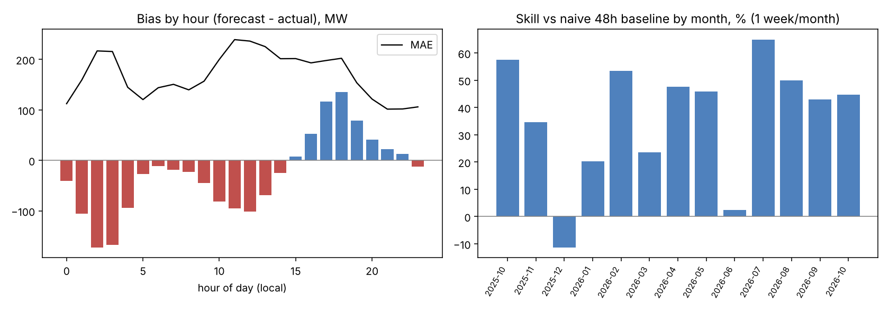

# forecast-skill-check

Независима проверка на дневна прогноза за потреблението (day-ahead load forecast):
колко греши, кога греши, и бие ли простите методи, със статистическа сигурност.
*Independent check of a day-ahead load forecast against naive baselines, with uncertainty.*

Не е прогнозен модел. Не подобрява прогнозата, а измерва нейното качество. Работи локално, данните не напускат машината ви.

## Какво смята
- MAE, RMSE, MAPE, bias (изместване), дял часове с грешка >5 % и >10 %
- по месец, по час от денонощието, най-лоши дни
- **умение (skill)** спрямо две наивни бази, използващи само реално потребление:
  - `naive48`: същият час преди 48 ч. Напълно известна към издаването на прогнозата; **коректната база**.
  - `naive24`: същият час преди 24 ч. Оптимистична, защото вечерните часове на D-1 не са известни към обед на D-1.
- skill = 1 − MAE_прогноза / MAE_база. Над 0 = прогнозата бие базата.
- 95 % интервал: block bootstrap по календарни дни (2000 извадки)
- брой серии от ≥3 часа с идентична стойност на прогнозата (подозрение за запълване)

## Употреба
```
pip install pandas numpy matplotlib
python forecast_skill_check.py "data/*.csv" --json results.json
python make_chart.py results.json chart.png
```
Вход: CSV с колони `MTU (CET/CEST)` (формат `DD/MM/YYYY HH:MM - DD/MM/YYYY HH:MM`), `Actual Total Load (MW)`, `Day-ahead Total Load Forecast (MW)` (експорт от ENTSO-E Transparency Platform). За други колони: `--time --actual --forecast`.
За собствени данни е достатъчна часова серия с време, реално потребление и прогноза.

## Пример на публични данни (ЕСО / България)
13 седмични експорта от ENTSO-E, по една седмица на месец, окт. 2025 – окт. 2026 (2 184 часа). Суровите CSV не са включени (изтеглете ги от ENTSO-E Transparency Platform: Load → Total Load - Day Ahead / Actual, област България, макс. 7 дни на заявка). Резултатът е в `example/`.

| Показател | Стойност |
|---|---|
| MAE | ≈ 168 MW |
| MAPE | ≈ 3,7 % |
| RMSE | ≈ 232 MW |
| Изместване | ≈ −26 MW (леко подценяване) |
| Часове с грешка >5 % / >10 % | 26 % / 5,6 % |
| Умение vs naive48 | +41 % (95 % ИИ: 31 % до 49 %) |
| Умение vs naive24 | +7 % (95 % ИИ: −5 % до +18 %), не се различава от 0 |

Наблюдения: нощни часове 01–04 ч. подценени със 100–170 MW; вечерни 17–19 ч. надценени с 80–135 MW; зимата е най-слаба (MAPE 4,4–5,1 %), лятото/есента най-добри (2,3–2,8 %); декември 2025 е единственият месец под наивната база.



## Ограничения (важно)
- Това е прогнозата на **оператора за цялата система**, не на търговец или портфолио. Не казва нищо за качеството на друга прогноза.
- Само 13 седмици (по една на месец). Изводи за отделни месеци са слаби; за целия период са по-стабилни.
- Базите се смятат само там, където лаговите стойности са в извадката; първите дни на всяка седмица нямат naive48.
- Грешката в MW не е разход в лева. За това са нужни цените на небаланса по часове.
- Серии с идентична прогноза са индикация за запълване, не доказателство.
- Резултатите не са независимо проверени от трето лице.

## Лиценз
MIT. Данните от ENTSO-E подлежат на условията на платформата.

Автор: Dimitar Kretski, Варна. ORCID 0000-0001-5108-2243
